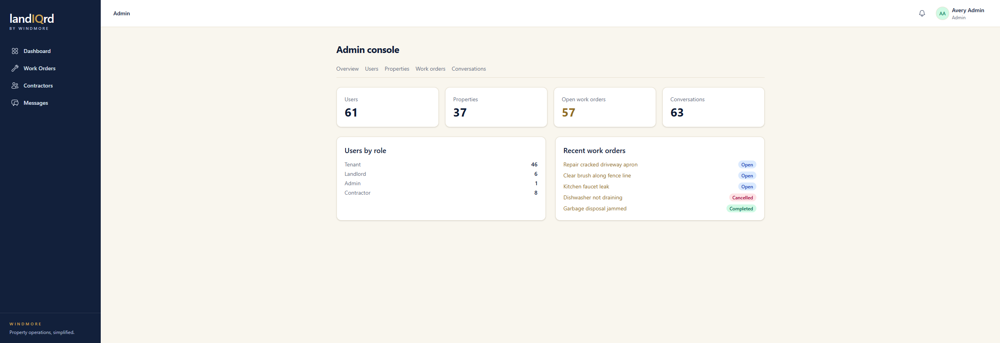
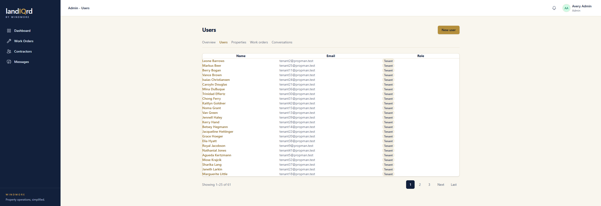

# Admin console

**Status:** Limited. Admin only.

Admins can run the user list. Everything else is look-but-don't-touch.

Sign in as `admin@propman.test`. The app opens on the admin overview rather than the landlord home page.

1. Counts for users, properties, open work orders, and conversations.
2. Users by role, and the latest work orders.
3. Tabs across the top: Overview, Users, Properties, Work orders, Conversations.

Open **Users**.

4. The list is name, email, and role, with pages. **New user** creates an account, including another admin. A row opens that user for edit or removal.

**Where it stops.** Properties, work orders, and conversations open as read-only pages. An admin cannot edit those records from here. Jobs and proposals do not appear in the admin console at all. The sidebar still has Work Orders, Contractors, and Messages, which are the same pages the other roles use, scoped to what an admin is allowed to see.
