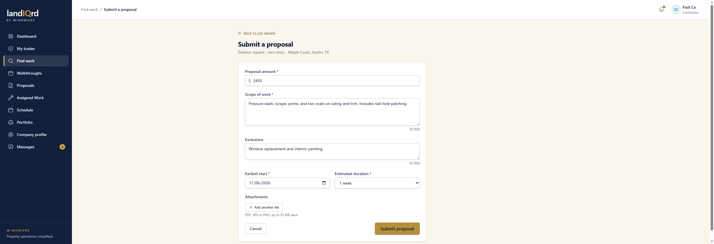
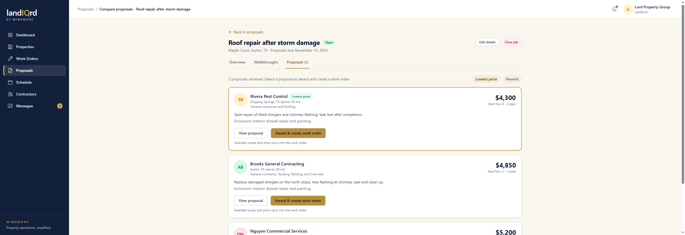
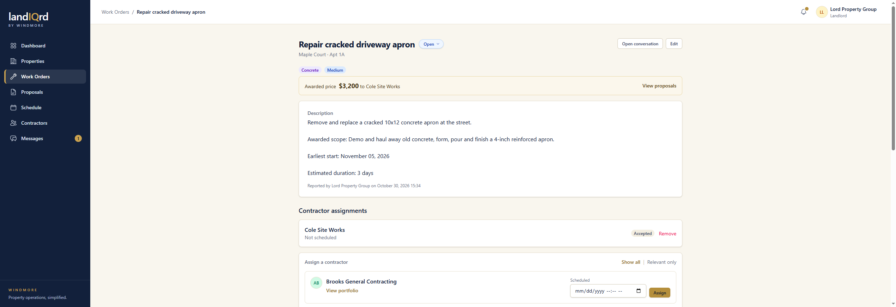

# Proposals and award

**Status:** Ready. Landlord and contractor.

A bid becomes the work order. That is the only place a dollar amount turns into an assignment. The lease's monthly rent is a separate number and is not paid through this flow.

A contractor opens a job that does not require a walkthrough, or books a time first, then **Submit a proposal**.

1. Amount, scope, exclusions, earliest start, duration, and optional files.
2. They can edit or withdraw while the job is still open. Submitting emails the landlord.
3. Their bids live under **Proposals** in the contractor sidebar.

The landlord opens the job's **Proposals** tab.

4. Bids sort by lowest price or newest. The cheapest card is marked. Each card shows the contractor, trades, price, start, duration, scope, and exclusions.

**Award & create work order** is the decision.

5. Award creates the work order at that price, accepts the winner, declines the other bids, closes the job, and copies image attachments onto the work order.
6. The gold banner is the awarded price and the contractor, with a link back to the proposals. The description includes the winning scope, exclusions, earliest start, and duration.
