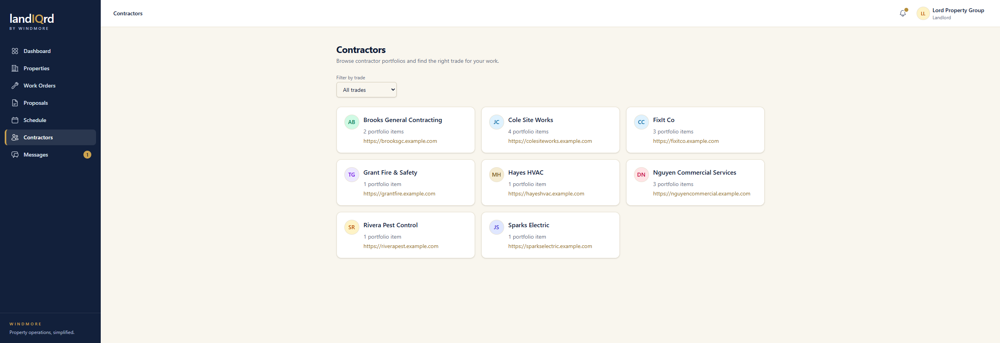
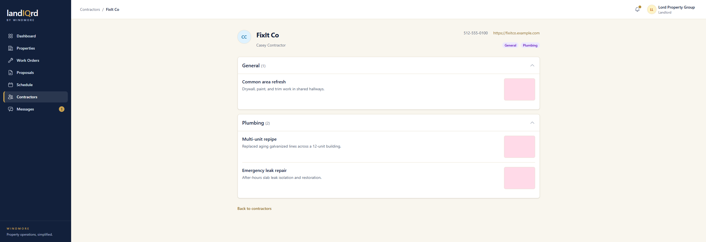
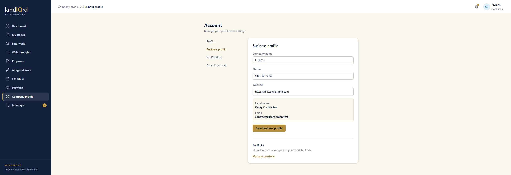
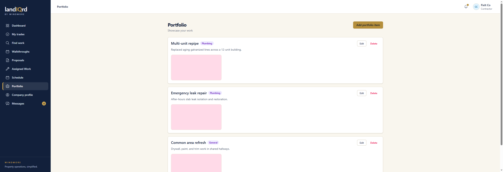

# Contractor directory and portfolio

**Status:** Ready. Landlord and contractor. Portfolio photos are the exception in [Photo thumbnails](photos.md).

Contractors publish a company card and examples of past work. Landlords browse that before assigning someone.

## What the landlord sees

Sign in as `landlord@propman.test`. Sidebar → **Contractors**.

Filter by trade. Each card is the company, how many portfolio items they have, and a website.

Open FixIt Co. **Direct assignment** on that page is how a landlord asks to save them for [quick jobs](quick-jobs.md).

Company, the person's name, phone, and website. Portfolio entries are grouped by trade: a title, a short description, and a photo. The pink tiles on this machine are the resize failure described in [Photo thumbnails](photos.md). The text of each job is stored and shows.

## What the contractor edits

Sign in as `contractor@propman.test`. Sidebar → **Company profile**.

Company name, phone, and website. Legal name and email stay on the account. **Manage portfolio** opens the list.

Each item has a trade, a description, photos, and Edit or Delete. **Add portfolio item** starts another. Landlords see this same set on the profile above.
