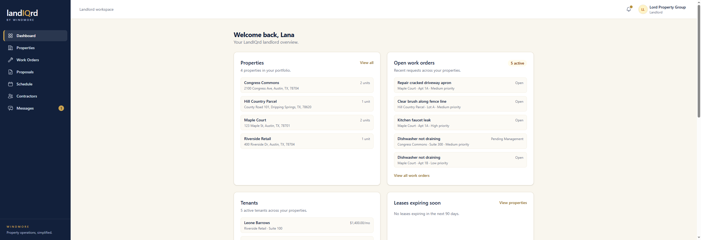
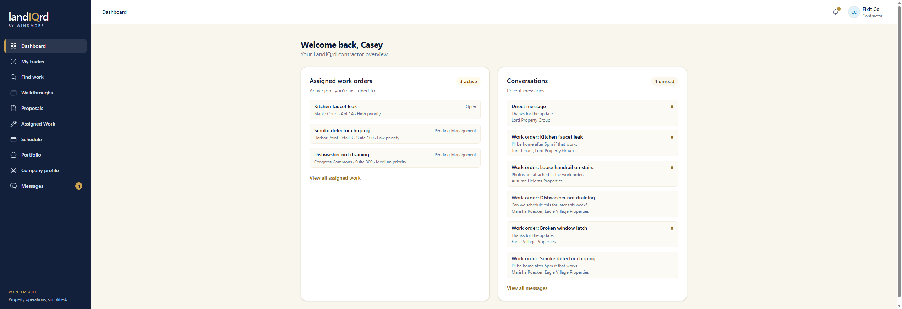
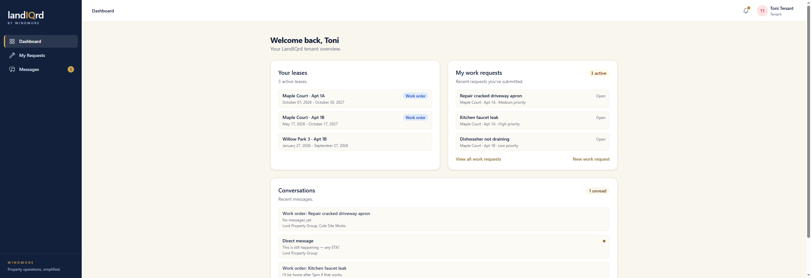

# Dashboards

**Status:** Ready. Landlord, contractor, and tenant. An admin is sent to the [admin overview](admin.md) instead.

Each role lands on the records they already own.

## Landlord

Sign in as `landlord@propman.test`.

Properties, open work orders, current tenants with their monthly rent, leases ending within 90 days, and recent conversations. The sidebar is Dashboard, Properties, Work Orders, Proposals, Schedule, Contractors, and Messages.

## Contractor

Sign in as `contractor@propman.test`.

Assigned work that is still active, and recent conversations. The sidebar adds My trades, Find work, Walkthroughs, Proposals, Assigned Work, Schedule, Portfolio, and Company profile.

## Tenant

Sign in as `tenant@propman.test`.

Active leases, requests that tenant opened, and conversations. The sidebar is only Dashboard, My Requests, and Messages. A tenant does not browse jobs, contractors, or the property portfolio.
