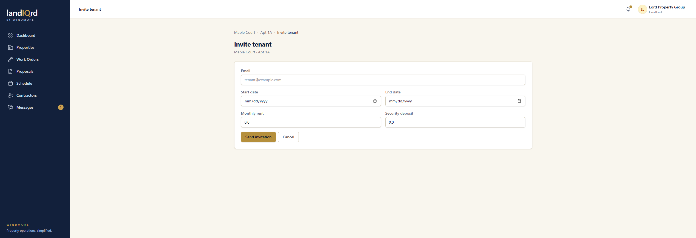

# Lease invitations

**Status:** Ready. Landlord and tenant.

A landlord can put someone on a unit before that person has an account.

From a unit, **Invite tenant**.

1. Enter an email, a start date, an end date, monthly rent, and a security deposit.
2. **Send invitation** emails a token link.
3. The recipient opens the link and creates a tenant account. That new account is accepted onto a draft lease for the unit. The email on the form is filled in from the invitation.
4. The landlord can be emailed when the invite is accepted. Invites expire, and can be cancelled.

Someone who is already signed in is asked to sign out before using the link. The link does not attach the lease to an account that already exists.
