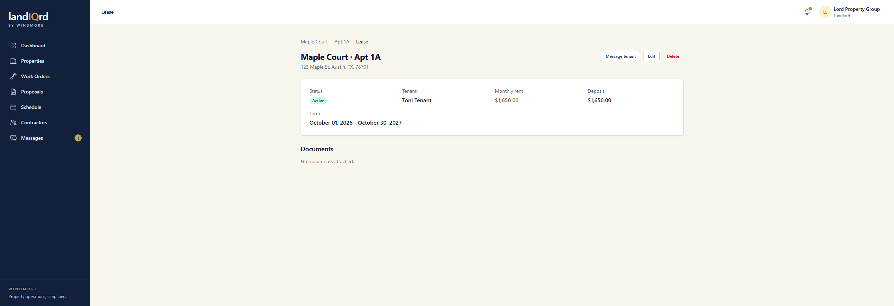

# Leases

**Status:** Ready. Landlord and tenant.

A unit has at most one active lease. The lease stores the term, the monthly rent, and the deposit. Collecting that rent is not part of the app. The lease file is an upload, not a signed envelope.

From Apt 1A, open the active lease. Or from the landlord dashboard, open a tenant.

1. Status moves through draft, active, ended, and terminated.
2. The page shows the tenant, the monthly rent, the deposit, and the term. **Message tenant** opens a direct thread. **Edit** changes the lease.
3. Documents attach on this page. This demo lease has none yet.
4. Each morning a job ends any active lease whose end date has passed, and can email the landlord and the tenant.
5. The landlord dashboard lists leases that end within 90 days. On this demo set, none do.

A tenant sees their own leases on the [dashboard](dashboards.md). They do not edit them.
