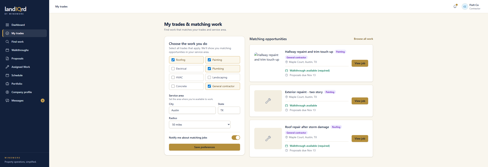

# Service-area matching

**Status:** Limited. Landlord and contractor.

Trades match for real. Distance is a label, not a calculation.

Sign in as `contractor@propman.test`. Sidebar → **My trades**.

1. Check trades and enter a city, a state, and a radius from 5 to 500 miles. Save preferences.
2. Matching opportunities on the right are open jobs that share a trade. **Find work** is the same set as a full list.
3. On the landlord's new-job form, the matching panel uses that same rule. Same city adds more to the score than same state. Someone with no state on file is treated as in the area.

**Where it stops.** The radius is saved and shown on the profile. Nothing measures miles, and nothing is geocoded. Two contractors in the same state rank the same whether the job is next door or across the state.
