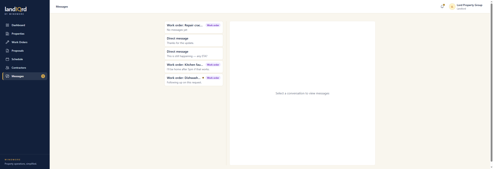
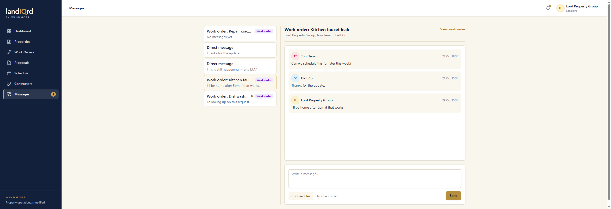

# Messages

**Status:** Ready. Landlord, contractor, and tenant.

A thread is either tied to a work order or a direct note between two people. New messages show up live. The sidebar badge counts unread threads. A message can include a file.

Sidebar → **Messages**.

The left column is the inbox. Work-order threads are badged. Direct messages are labeled as such.

Open the kitchen faucet thread.

1. A work-order thread includes the person who opened it, the landlord, the current tenant, and any assigned contractors. This one is Lord Property Group, Toni Tenant, and FixIt Co.
2. **View work order** jumps back to the request. The composer is at the bottom, with a file picker.
3. A direct message is started from **Message tenant** on a lease, or from Messages with another user. It is not tied to a work order.
