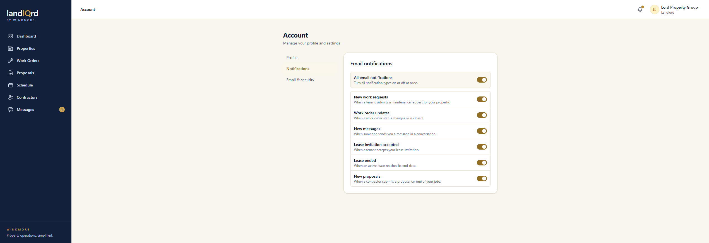

# Email notifications

**Status:** Ready. Landlord, contractor, and tenant.

Twelve emails, each optional, and each shown only to the roles it applies to. Toggles save on their own. The screenshot below was taken before direct-work requests, contact responses, and job responses were added.

Account → **Notifications**. Signed in as the landlord:

Landlords can hear about new work requests, status changes, messages, accepted invites, ended leases, new proposals, a contractor accepting or declining a contact, and a contractor accepting or declining a job.

Contractors, on their own account page, can hear about status changes, assignments, messages, matching jobs, awarded proposals, and a landlord asking to assign jobs directly. **All email notifications** turns the whole set off.

Tenants can hear about status changes, messages, and an ended lease.
