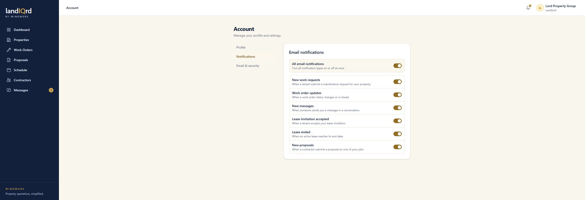

# Email notifications

**Status:** Ready. Landlord, contractor, and tenant.

Nine emails, each optional, and each shown only to the roles it applies to. Toggles save on their own.

Account → **Notifications**. Signed in as the landlord:

Landlords can hear about new work requests, status changes, messages, accepted invites, ended leases, and new proposals.

Contractors, on their own account page, can hear about status changes, assignments, messages, matching jobs, and awarded proposals. **All email notifications** turns the whole set off.

Tenants can hear about status changes, messages, and an ended lease.

Text messages use the same twelve types, and each one starts off. The phone form and the text toggles stay hidden until `SMS_ENABLED` is turned on. Lease invitations stay email-only.
