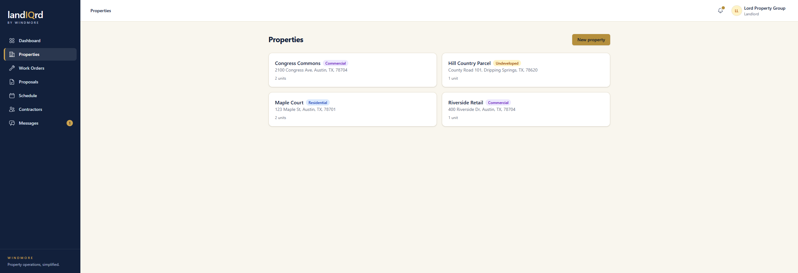
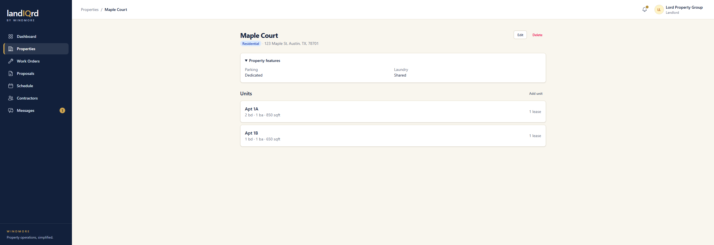
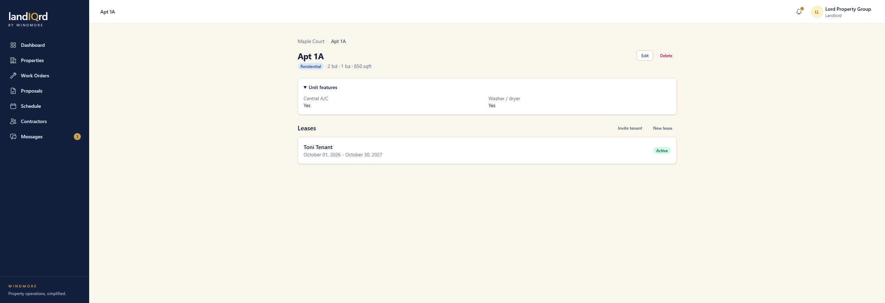

# Properties and units

**Status:** Ready. Landlord.

The portfolio is properties, then units. The extra fields change with the property type. A landlord only sees their own properties.

Sign in as `landlord@propman.test`. Sidebar → **Properties**.

Each card is a name, a type (residential, commercial, or undeveloped), an address, and a unit count. **New property** starts another one.

Open Maple Court.

The header is the type and the address. Property features on this residential building are parking and laundry. Commercial properties ask about an elevator, sprinklers, ADA access, and a loading area. Land asks about frontage, fencing, and easements. **Add unit** sits on the units list.

Open Apt 1A.

A unit has a label, bedrooms, bathrooms, and square feet. Unit features here are central air and a washer and dryer. Commercial units add use class, parking spaces, a loading dock, ceiling height, and restrooms. Land units add zoning, utility hookups, topography, and flood zone. The leases on the unit are listed underneath, with **Invite tenant** and **New lease**.
