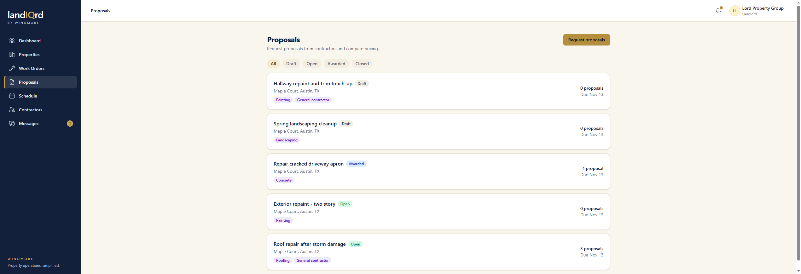
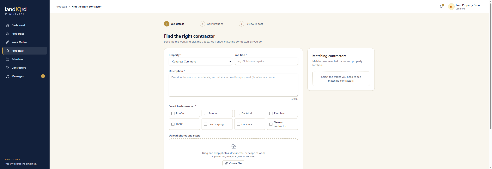
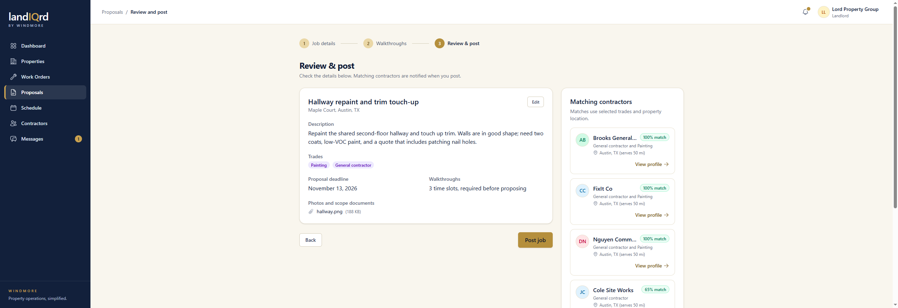
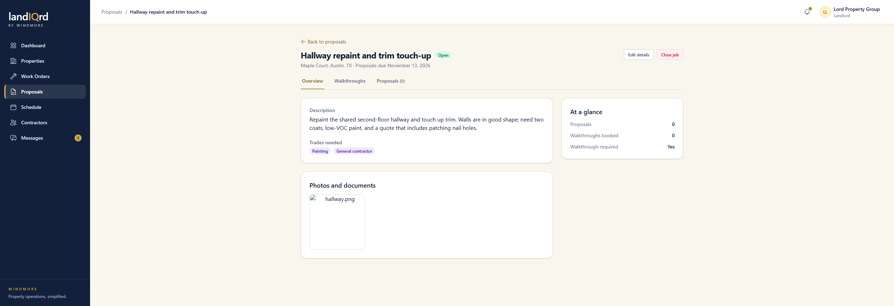
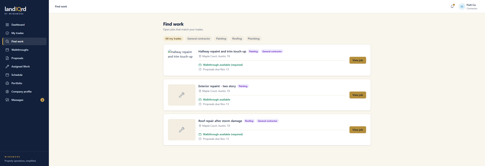

# Request for proposals

**Status:** Ready. Landlord and contractor.

A job is a request for priced proposals. It stays separate from a work order until someone is awarded. The picture-by-picture version of this flow is the [marketplace walkthrough](../walkthrough/README.md).

Sign in as `landlord@propman.test`. Sidebar → **Proposals**.

Every request, with status (draft, open, awarded, closed), trades, a proposal count, and a deadline. **Request proposals** starts one. **Quick job** skips this list and assigns a saved contractor. That path is in [Quick jobs](quick-jobs.md). Filter chips limit the list.

1. Pick the property, a title, a description, one or more trades, a deadline, and photos or a PDF (up to 25 MB).
2. The matching panel lists contractors who share a trade. Same city ranks above same state. How far that match actually reaches is in [Service-area matching](matching.md).
3. Walkthrough times are the next step, then review.

4. Review confirms the job and who will be emailed. **Post job** opens it. Contractors who opted in get a matching-job email.
5. An open job can still be edited, or closed with no award.

Overview, Walkthroughs, and Proposals tabs. The glance card counts proposals and booked walkthroughs.

A contractor finds open jobs under **Find work**.

