# Quick jobs

**Status:** Ready. Landlord and contractor.

A quick job skips proposals and walkthroughs. The landlord asks to save a personal or business contact. The contractor accepts that relationship, then accepts each job. The bid path is still [Request for proposals](proposals.md). Putting someone on a work order that already exists is [Assigning a contractor](assigning-contractors.md).

The happy path uses `landlord@propman.test` and `contractor@propman.test` (FixIt Co). The decline shots use `contractor2@propman.test` (Sparks Electric).

## 1. Landlord asks to save the contractor

Sign in as the landlord. Sidebar → **Contractors** → FixIt Co.

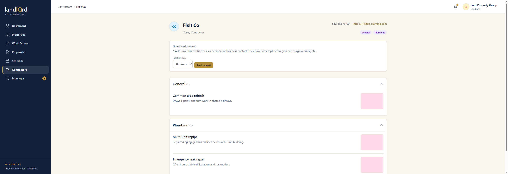

**Direct assignment** sits above the portfolio. Choose **Personal** or **Business**, then **Send request**. Personal and business are the same permission. The label is only how the landlord knows them.

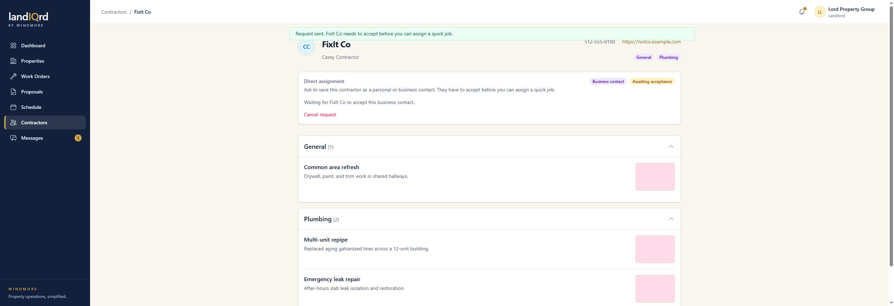

The card shows **Business contact** and **Awaiting acceptance**. **Cancel request** withdraws it. A quick job cannot be sent yet.

The contractor is emailed, unless they turned off direct-work requests.

## 2. Contractor accepts or declines the relationship

Sign in as the contractor. Sidebar → **Contacts**. A badge counts requests that are still waiting.

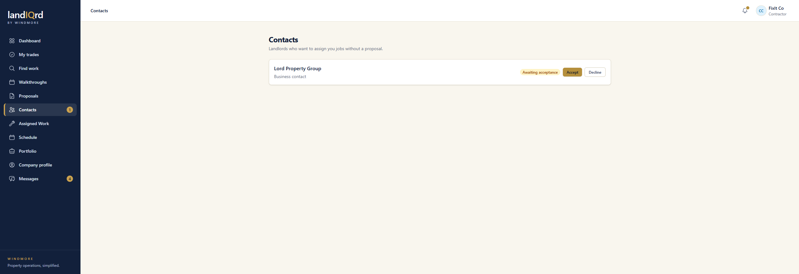

Each row is the landlord, personal or business, and the status. **Accept** or **Decline**.

After **Accept**, the row stays and the badge is gone. There is nothing left to click.

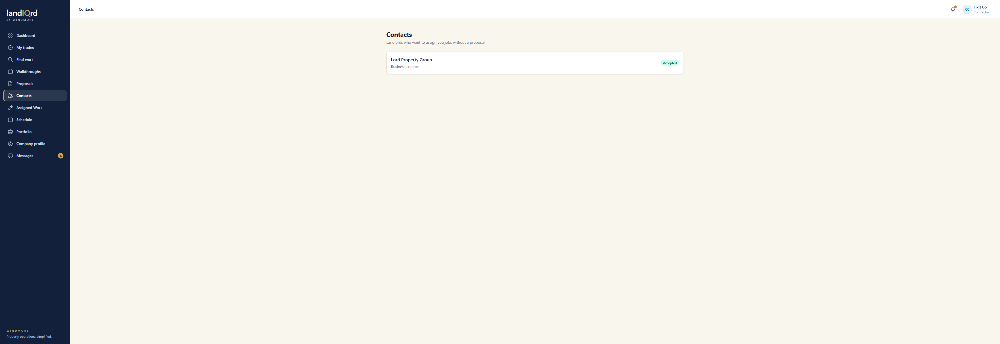

**Decline** leaves the row as **Declined**. This shot is Sparks Electric, after Lord Property Group sent a personal request.

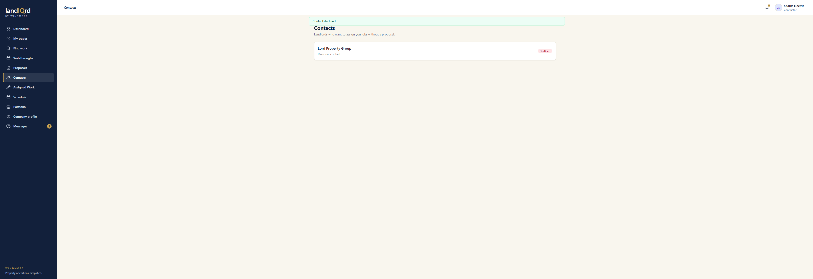

The landlord is emailed either way.

## 3. Landlord sees the answer

Back on the contractor's profile.

Accepted: change **Personal** or **Business**, **Assign a quick job**, or **Remove contact**. Removing the contact means they have to accept again before another quick job.

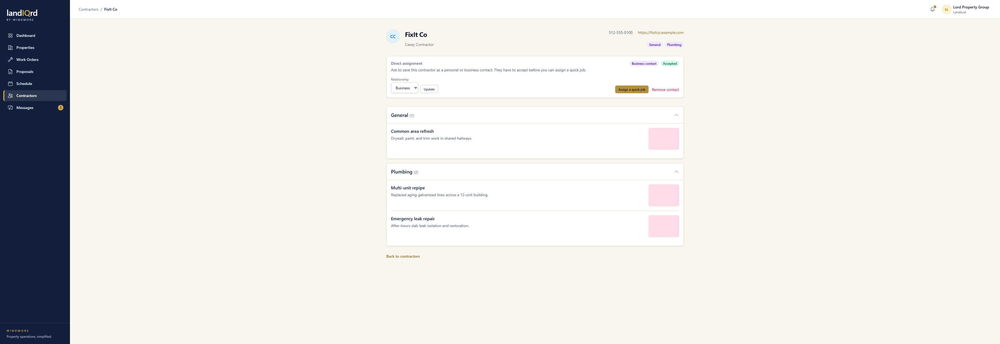

Declined: **Request again** sends the same request back to pending. **Remove contact** drops it.

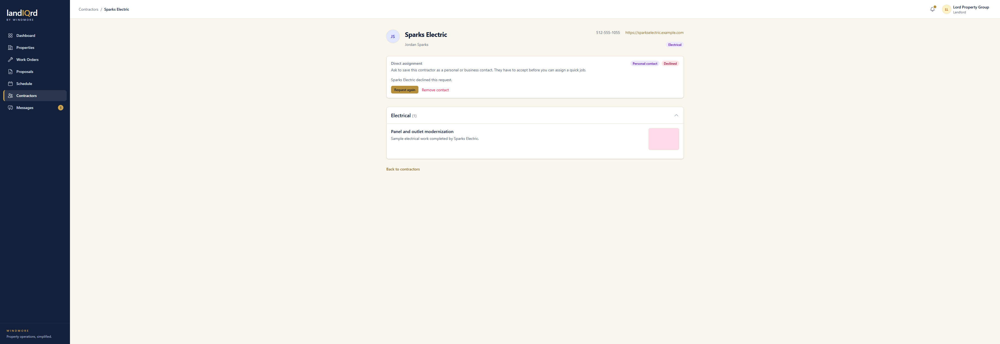

**My contractors** on the directory is that same list: accepted, still waiting, and declined.

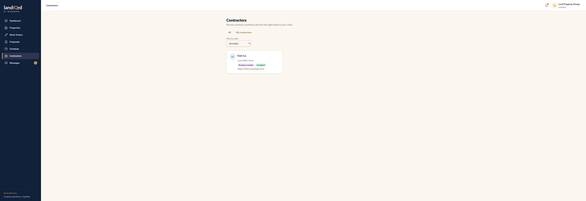

## 4. Landlord sends the job

**Quick job** is on **Work Orders** and on **Proposals**. **Assign a quick job** is on an accepted contractor's profile. The list only includes contacts who have accepted.

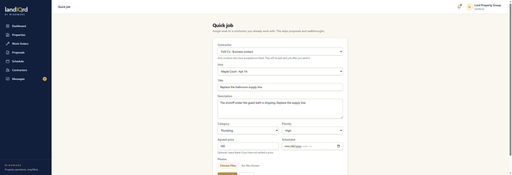

1. Pick the contractor and one of your units.
2. Title, description, category, and priority. The category list follows the unit, the same way a normal work request does.
3. **Agreed price** is optional. Leave it blank if the price is not settled.
4. **Scheduled** is optional. **Photos** are optional.
5. **Assign job** creates the work order. It does not post a proposal request.

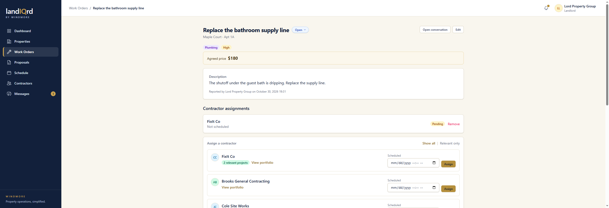

The work order shows **Agreed price** when one was entered. FixIt Co is on the job as **Pending**. The activity log says the landlord sent the job and is waiting. The contractor is emailed.

## 5. Contractor accepts or declines the job

Sign in as the contractor. **Assigned Work** → the job.

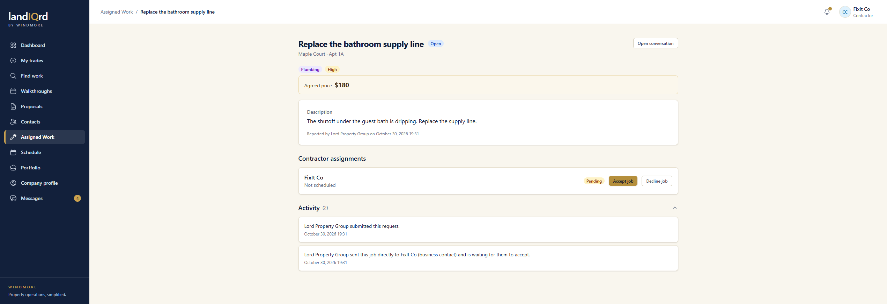

**Accept job** or **Decline job**. The same two buttons appear on any pending assignment, including one made from the work order page rather than Quick job.

After **Accept**, the status menu is how they mark it completed later. **Decline** sets the assignment to **Declined**. The landlord can assign someone else from the same work order.

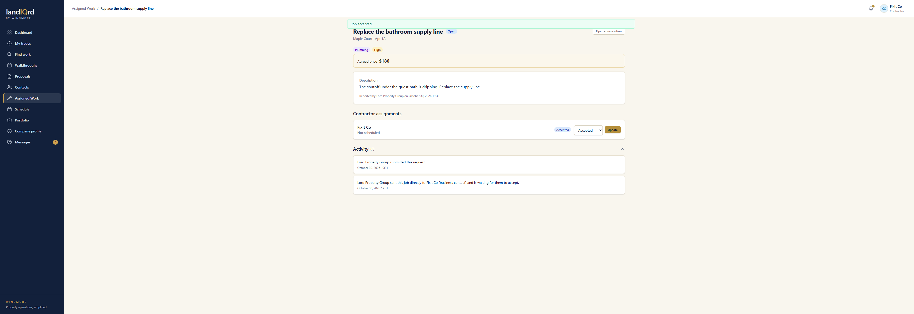

The landlord is emailed when the job is accepted or declined. The work order's message thread already includes both of them.

## 6. Landlord sees the job answer

The assignment badge is **Accepted**. **Agreed price** stays on the work order. The activity line from the send is still there.

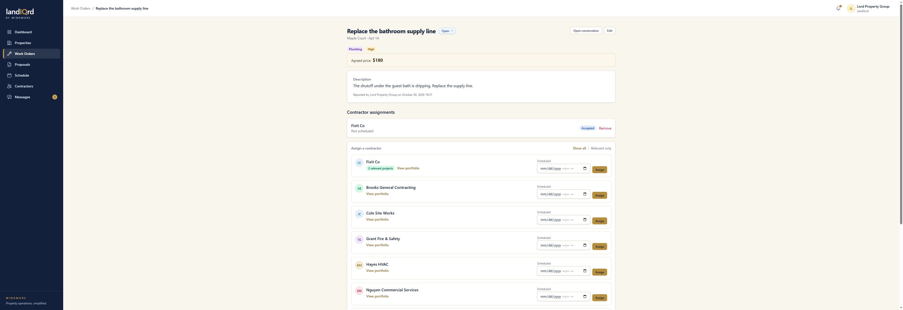

A declined job uses the same badge in red. The landlord can assign another contractor from this page, or send a new quick job to a different accepted contact.
