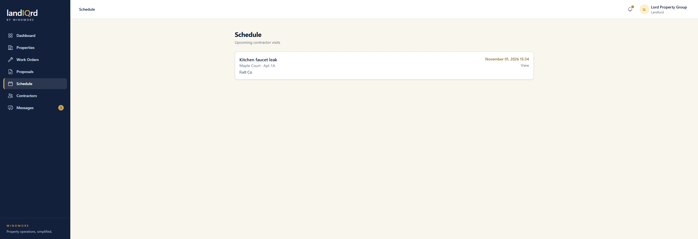

# Schedule

**Status:** Limited. Landlord and contractor.

Schedule is a list of upcoming contractor visits, not a calendar.

Sidebar → **Schedule**.

1. When a work-order assignment has a date, it shows here with the property, the unit, and the contractor.
2. **View** opens that work order. This demo visit is FixIt Co on the kitchen faucet leak, November 1.

**Where it stops.** Walkthrough bookings are not on this list. They live under Walkthroughs on a job, and under Walkthroughs in the contractor sidebar. There is no month view and no calendar sync.
