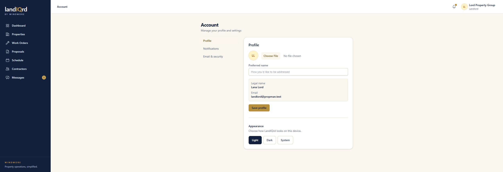

# Sign in and account

**Status:** Ready. Landlord, contractor, tenant, and admin.

The front door is the wordmark on a cream page. There is no marketing site in front of it.

1. Sign in, create an account, or reset a password. Sign-up offers tenant, landlord, or contractor.
2. An invite link forces the tenant role. Admins are created in the admin console, not on the public form.
3. Account holds a preferred name and avatar, a light or dark theme for this device, notification toggles, and email and password.

Sign in as `landlord@propman.test`, then open the name in the header and choose the account page. Profile, Notifications, and Email & security sit in the left column of that page.

Legal name and email are shown and are not edited on this form. Appearance is Light, Dark, or System.
