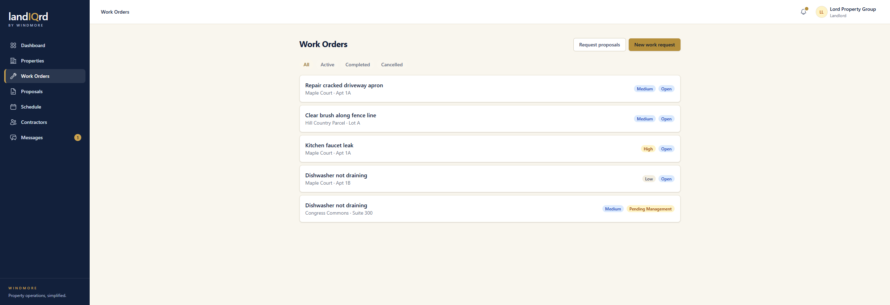
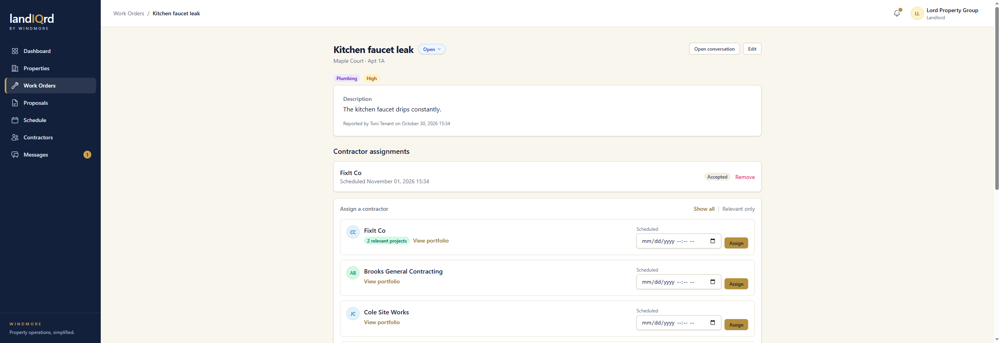

# Work orders

**Status:** Ready. Landlord, tenant, and contractor.

A work order is the shared record for a repair, from the first report through close. Awarding a proposal is a second way to create one. That path is in [Proposals and award](award.md).

Sign in as `landlord@propman.test`. Sidebar → **Work Orders**.

Filter chips are All, Active, Completed, and Cancelled. Each row is the title, the property and unit, a priority, and a status. **New work request** starts one. **Request proposals** jumps to the bid flow instead.

Open Kitchen faucet leak.

1. A tenant or a landlord opens a request with a title, a category, a priority, and photos.
2. Categories follow the unit. Commercial adds fire safety, signage, accessibility, and structural. Land adds site work, fencing, utilities, grading, and environmental.
3. Status moves through open, waiting on the tenant, waiting on management, on hold, completed, or cancelled. Closing requires a reason. Tenants can close and reopen their own requests.
4. The page names who reported it and when. Every change is written to an activity log further down the page.
5. A contractor sees the work orders they are assigned to under **Assigned Work**. A tenant sees theirs under **My Requests**.
