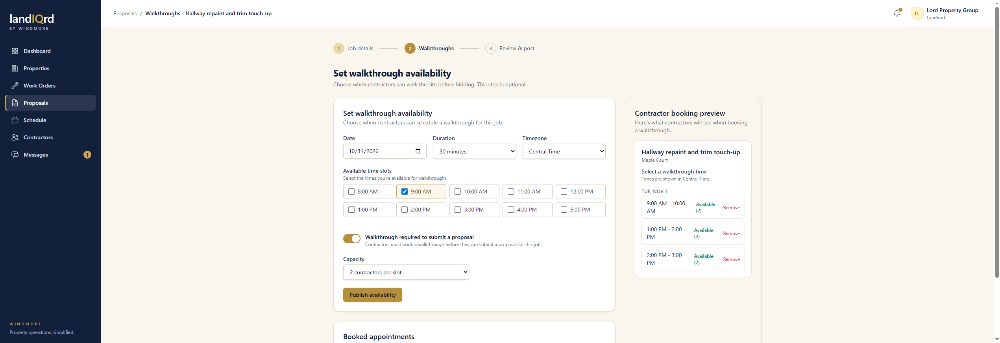
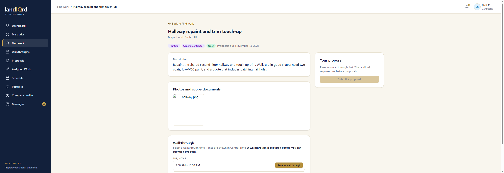

# Marketplace and design walkthrough

Guided tour of the request-for-proposals flow and the navy, gold, and cream layout. Screenshots are from a fresh demo database (`password123` on every account below). The app in these shots is running at `http://localhost:3000`.

| Role | Email |
|---|---|
| Landlord | `landlord@propman.test` |
| Contractor | `contractor@propman.test` |
| Tenant | `tenant@propman.test` |

## What changed

- **Design.** Cream page background, navy sidebar, gold buttons and the gold "IQ" in the wordmark. Signed-in pages use a left sidebar instead of a top nav. The header shows the current section, then the page title.
- **Proposals.** A landlord describes a job, picks trades, attaches photos or a PDF, optionally publishes walkthrough times, and posts it. Matching contractors are ranked by shared trades and the same city or state. They are not geocoded.
- **Contractor side.** My trades, Find work, walkthrough booking, and a priced proposal (amount, scope, exclusions, start, duration, files).
- **Award.** Choosing a proposal creates a work order at that price, assigns the contractor, declines the other proposals, and closes the job.

Payments are not part of this pass.

## 1. Sign in

The wordmark sits on the cream page above the form card. Gold "IQ", gold rule, gold Log in button. Sign up and password reset use the same screen.

## 2. Landlord dashboard

Sign in as `landlord@propman.test`.

The sidebar is Dashboard, Properties, Work Orders, Proposals, Schedule, Contractors, and Messages. The header reads "Dashboard". Panels are the existing portfolio, work orders, tenants, leases, and conversations, restyled onto cream cards.

## 3. Proposal list

Sidebar → **Proposals** (`/jobs`).

Every request for proposals, with status (Draft, Open, Awarded, Closed), trades, proposal count, and deadline. **Request proposals** starts a new one. Filter chips along the top limit the list.

The demo set includes a roof job with three bids, an open painting job, an awarded concrete job, a landscaping draft, and the hallway job created in the steps below.

## 4. Job details

**Request proposals.**

Three steps: Job details, Walkthroughs, Review & post. The landlord picks a property, writes the title and description (1,000 character counter), checks one or more trades, and can drop in JPG, PNG, or PDF files up to 25 MB. The deadline is required before posting.

The **Matching contractors** panel updates as trades and the property change. Score is trade overlap plus a city or state bonus. A contractor who has not set a service area is treated as in-area.

## 5. Review and post

After saving details and walkthroughs, **Continue to review**.

Confirms title, description, trades, deadline, walkthrough rules, and attachments, and lists who will be notified. **Post job** opens the job and emails matching contractors who opted in.

## 6. Walkthrough times

Step 2, or the Walkthroughs tab on a posted job.

Pick a date, duration, timezone, and one or more hours. **Walkthrough required to submit a proposal** blocks bids until that contractor has a confirmed slot. Capacity is how many contractors can book the same time. The right-hand card is the contractor preview, including already published slots and a remove link.

On this job the published slots are Tuesday, Nov 3, 9:00–10:00, 1:00–2:00, and 2:00–3:00 Central, two contractors each, and a walkthrough is required.

## 7. Posted job

Overview, Walkthroughs, and Proposals tabs. The landlord can edit details while the job is open, or close it without awarding. The glance card counts proposals and booked walkthroughs.

## 8. Compare proposals

Open the seeded roof job → **Proposals**.

Bids sort by lowest price or newest. The cheapest card is outlined and badged. Each card shows the contractor, trades, price, start date, duration, scope, and exclusions. **Award & create work order** is the decision.

## 9. Awarded work order

The seeded concrete job was already awarded. Work Orders → that job.

A gold banner shows the awarded price and contractor, with a link back to the proposals. The description includes the awarded scope, exclusions, earliest start, and duration. The winning contractor is assigned as Accepted. Other proposals on that job are declined.

## 10. Contractor trades

Sign out, then sign in as `contractor@propman.test`. Sidebar → **My trades**.

The contractor checks trades, sets city, state, and radius, and can turn matching-job email on or off. **Save preferences** stores it. Matching opportunities on the right are open jobs that share a trade. This account is roofing, painting, plumbing, and general, based in Austin, TX, within 50 miles.

The contractor sidebar is Dashboard, My trades, Find work, Walkthroughs, Proposals, Assigned Work, Schedule, Portfolio, Company profile, and Messages.

## 11. Find work

Sidebar → **Find work**.

Open jobs for the contractor's trades, with a chip per trade. Each card shows a photo when one was uploaded, the property location, whether a walkthrough is available (and required), and the proposal deadline.

## 12. Job detail and booking

**View job** on the hallway repaint.

Description, attachments, and bookable times in the job's timezone. Because this job requires a walkthrough, **Submit a proposal** stays disabled until a slot is reserved. **Reserve walkthrough** books one slot. The contractor can hold only one active booking per job, and a full slot cannot be double-booked.

## 13. Submit a proposal

The exterior repaint does not require a walkthrough, so Find work → that job → **Submit a proposal**.

Dollar amount, scope and exclusions (500 characters each), earliest start, duration, and optional PDF or image attachments. Submitting notifies the landlord. The contractor can edit or withdraw the proposal while the job is still open, from **Proposals** in the sidebar.

## Rough edges

- The contractor nav item is labeled **Assigned Work**, not Work Orders. That label predates this pass.
- Header crumbs repeat a long page title, for example `Proposals / Compare proposals - Roof repair after storm damage`.
- Avatar, portfolio, and work-order photo thumbnails still go through Active Storage variants. This machine has neither libvips nor ImageMagick, so those older thumbnails 500. Job photos in this flow are served as the original file and display.
